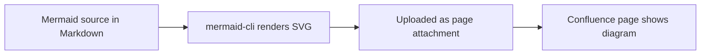

# Welcome to the Beta documentation

This is the second dummy repository in the docs-as-code proof of concept. It
publishes into the *same* Confluence space as `confluence-docs-alpha`, but
under its own root page — the two repositories can never modify or delete
each other's pages.

## Publishing pipeline

## Reading order

1. [Beta Getting Started](getting-started.md) — setup basics.
2. [Beta API Reference](reference/api.md) — endpoints and examples.

## Screenshot

## External link

- [GitHub Actions documentation](https://docs.github.com/en/actions)

## Isolation rules

- Pages are tagged with the repository that owns them.
- A repository only ever touches pages beneath its own root page.
- Deletions are further limited to pages it created itself.
