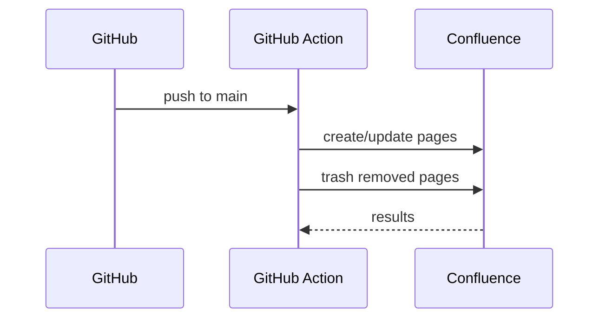

# Beta API Reference

## Sync endpoints (conceptual)

## Methods

| Method | Purpose |
|---|---|
| `sync.py` | Reconcile pages |
| `render_mermaid.py` | Render diagrams |
| `validate.py` | PR checks |

Back to [Beta Documentation Home](../index.md).
